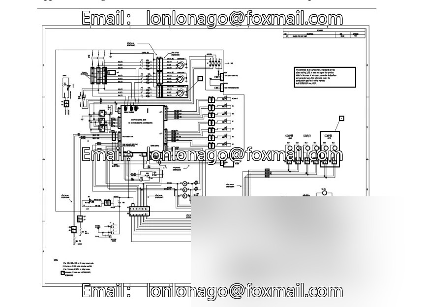
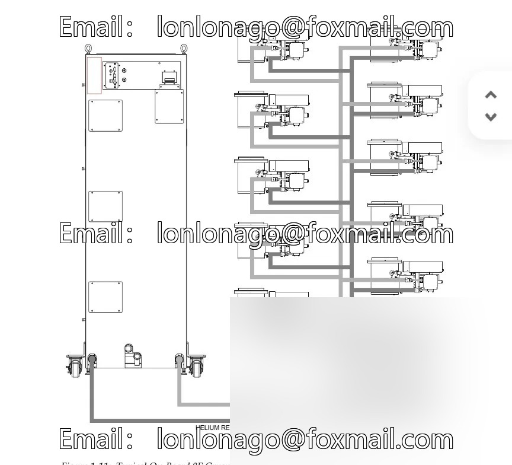
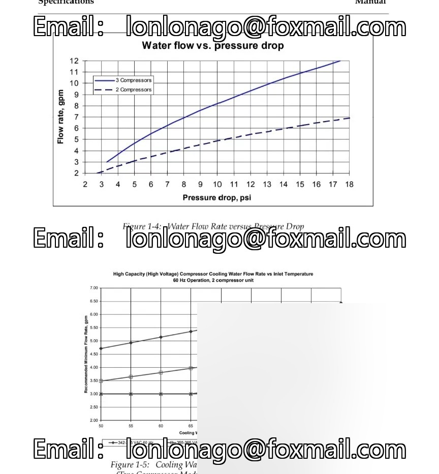

# Brooks Automation / CTI-Cryoge

## Body

Brooks Automation / CTI-Cryogenics High-Capacity Helium Compressor Installation, Operation and Maintenance Manual, Model 8040600 Rev A.
PDF electronic file 80 pages
The document details the installation, operation and maintenance procedures of the compressor, applicable to On-Board® low-temperature pump or Cryo-Torr low-temperature pump, providing high-pressure helium gas circulation power.

non-refundable upon sale.
7348

The manual explains the installation, operation and maintenance process of the compressor, applicable to On-Board low-temperature pumps or Cryo-Torr low-temperature pumps, providing high-voltage helium gas circulation power; the document is 80 pages and includes specific parameters and curves.

<!-- AI_ENRICHED -->

## Images

## Payment

Here is a pay link on Stripe ( https://buy.stripe.com/3cs8yP7sY87d0vu9AB ). Please contact me lonlonago@foxmail.com after funding $89, and I will send you a complete data files , thank you!

